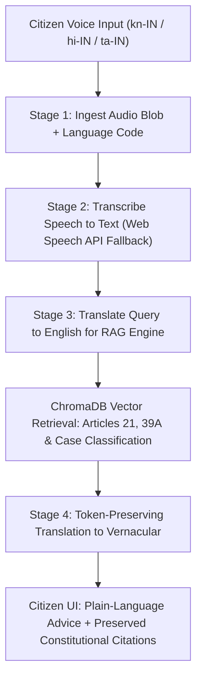

<<<<<<< HEAD
# NyayaConnect

NyayaConnect is a Next.js 14 demo for constitutional information, verified lawyer discovery, transparent milestone fees, and booking progress.

## Setup

```bash
npm install
npm run dev
```

Set environment variables in `.env.local`:

```env
NEXT_PUBLIC_USE_MOCKS=true
NEXT_PUBLIC_API_BASE_URL=https://your-api.example
```

`NEXT_PUBLIC_USE_MOCKS=true` (the default unless explicitly set to `false`) uses local JSON fixtures and simulated latency. The demo does not need a backend. `NEXT_PUBLIC_API_BASE_URL` is required when mocks are disabled. The browser stores demo bookings in localStorage under `nyayaconnect-bookings-v1`; clearing that key resets the demo. Voice recording requires a secure browser context and microphone permission.

## Folder structure

- `src/app/` — App Router pages and global styles
- `src/components/` — chat, voice, lawyer cards, booking modal, fee breakdown, and milestone UI
- `src/context/BookingContext.jsx` — shared chat summary and persisted mock bookings
- `src/hooks/` — client data hooks
- `src/mocks/` — lawyer and RAG response fixtures
- `src/services/apiClient.js` — all data access and mock/live switching

## API client functions

- `getLawyers(filters)` and `getLawyerById(id)` — lawyer directory and profile
- `askLegalQuestion(query, lang)` — constitutional RAG answer with citations, suggested category, and confidence
- `submitVoiceQuery(blob, lang)` — voice transcription (and optionally `rag_response` in a live response)
- `createBooking(payload)` and `getBookings()` — booking creation and retrieval
- `updateMilestone(bookingId, milestoneIndex, status)` — milestone status update

Live endpoint paths are `/lawyers`, `/lawyers/:id`, `/legal-question`, `/voice-query`, `/bookings`, and `/bookings/:id/milestones/:index`. Keep components calling the API client rather than fetching directly.
=======
# NyayaConnect: Vernacular Legal Advisor & Lawyer Marketplace (FSD)

[](https://github.com/abhishekravih/Legal-advisor-FSD)
[](https://sdgs.un.org/goals/goal16)
[](docker-compose.yml)
[](https://fastapi.tiangolo.com)
[](https://nextjs.org)
[](https://www.trychroma.com)

**Legal-advisor-FSD** is a unified full-stack legal intelligence platform engineered inside Google Antigravity. It empowers Indian citizens to ask legal questions in regional languages (Kannada, Hindi, Tamil, Telugu, etc.), grounds answers in the Constitution of India via ChromaDB RAG, and instantly connects citizens with verified affordable lawyers with upfront pricing and 4 Smart Milestones.

---

## 🏛️ Person 4: System Integration & DevOps Architecture

As **Person 4 (Systems Integrator and DevOps Lead)**, this repository establishes the unified multi-service monorepo, container orchestration, Git worktree workflow, and the 4-stage vernacular voice-to-RAG translation bridge.

```
Legal-advisor-FSD/
├── .antigravity/
│   └── workflows/
│       └── sync-stack.md           # Antigravity Git worktree & branch sync workflow
├── backend/                        # Person 2 (FastAPI Marketplace Backend)
│   ├── routers/
│   │   ├── voice_bridge.py         # Phase 2: 4-Stage Vernacular Voice-to-RAG Bridge
│   │   ├── orchestrator.py         # Step 3: Composite 'Ask -> Classify -> Recommend' API
│   │   └── lawyers.py              # Lawyer marketplace & 4 Smart Milestones
│   ├── database.py                 # MySQL database connector with resilient fallback
│   ├── schema.sql                  # Mapped to /docker-entrypoint-initdb.d/1_schema.sql
│   ├── requirements.txt            # Python dependencies
│   ├── main.py                     # Standardized CORS middleware & route registration
│   └── Dockerfile                  # Optimized python:3.11-slim container
├── frontend/                       # Person 1 (Next.js 14 Vernacular UI)
│   ├── src/
│   │   ├── app/                    # Next.js App Router (page.tsx, layout.tsx)
│   │   ├── services/
│   │   │   └── apiClient.ts        # Live API client with NEXT_PUBLIC_USE_MOCKS toggle
│   │   └── utils/
│   │       └── voiceFallback.ts    # Web Speech API zero-latency fallback engine
│   ├── package.json
│   ├── next.config.js
│   ├── tsconfig.json
│   └── Dockerfile                  # Multi-stage production container
├── rag_service/                    # Person 3 (ChromaDB Constitutional Engine)
│   ├── chroma_db/                  # Persistent vector database volume
│   ├── main.py                     # POST /api/v1/rag/ask endpoint with legal classification
│   ├── requirements.txt
│   └── Dockerfile                  # Python container with ChromaDB & vector index
├── .env.example                    # Standardized port and environment template
├── docker-compose.yml              # Master 4-service container orchestration
└── README.md
```

---

## 🔌 Standardized Port Allocations

All service ports are standardized across Docker containers and local development:

| Service | Port | Host Address | Description |
| :--- | :--- | :--- | :--- |
| **Frontend** | `3000` | `http://localhost:3000` | Next.js 14 Vernacular UI & Voice Recorder |
| **Marketplace API** | `8000` | `http://localhost:8000` | FastAPI Backend Gateway & Orchestrator |
| **RAG Service** | `8001` | `http://localhost:8001` | ChromaDB Constitutional Vector Engine |
| **Database** | `3306` | `localhost:3306` | MySQL 8.0 Relational Store |

---

## 🎙️ Phase 2: 4-Stage Vernacular Voice-to-RAG Pipeline

Located at [`backend/routers/voice_bridge.py`](backend/routers/voice_bridge.py), the voice bridge exposes `POST /api/v1/voice/ask`:



### Citation Preservation Technique
To prevent translation engines from corrupting statutory references (e.g. converting "Article 21" into localized numerals), citations are replaced with unique tokens (`__CONSTITUTIONAL_ARTICLE_0__`) before translation and restored verbatim afterward.

### Web Speech API Zero-Latency Fallback
Located at [`frontend/src/utils/voiceFallback.ts`](frontend/src/utils/voiceFallback.ts), the browser utilizes `window.SpeechRecognition` / `webkitSpeechRecognition` to stream real-time transcripts locally on the client hardware. This guarantees zero-latency responsiveness even on restricted college, hackathon, or mobile Wi-Fi networks.

---

## ⚖️ Step 3: Composite Orchestrator Flow

Exposed at `POST /api/v1/orchestrate/legal-assist`:
1. Receives citizen legal inquiry.
2. Queries RAG engine (`/api/v1/rag/ask`) to retrieve Constitutional Articles and determine case classification (`'Civil'`, `'Consumer'`, or `'Criminal'`).
3. Queries MySQL database for the top 3 verified lawyers in that exact category, sorted by transparent consultation fee affordability.
4. Returns unified JSON payload with 4 Smart Milestones in **<3 seconds**.

---

## 🐳 Quickstart: 1-Command Local Boot

```bash
# 1. Clone repository
git clone https://github.com/abhishekravih/Legal-advisor-FSD.git
cd Legal-advisor-FSD

# 2. Copy environment configuration
cp .env.example .env

# 3. Boot all 4 containers with Docker Compose
docker compose up --build -d

# 4. Access services
# Frontend:     http://localhost:3000
# Backend API:  http://localhost:8000/docs
# RAG Service:  http://localhost:8001/docs
```

---

## 🔄 Antigravity Worktree Sync Workflow

Use the Antigravity workflow at [`.antigravity/workflows/sync-stack.md`](.antigravity/workflows/sync-stack.md) to manage isolated branches for each team member:

```bash
# Pull and isolate team branches into worktrees
git worktree add -B frontend-p1 ../nyayaconnect-worktrees/frontend
git worktree add -B backend-p2 ../nyayaconnect-worktrees/backend
git worktree add -B rag-p3 ../nyayaconnect-worktrees/rag_service
```

---

## 📋 Handoff Deliverables Matrix

| Deliverable / Artifact | Workspace Location | Consumed By |
| :--- | :--- | :--- |
| **Vernacular Voice-to-RAG Bridge** | `backend/routers/voice_bridge.py` | Person 1 (Voice Recorder UI) |
| **Web Speech API Fallback** | `frontend/src/utils/voiceFallback.ts` | Person 1 (Client Hardware) |
| **Unified Orchestrator Endpoint** | `POST /api/v1/orchestrate/legal-assist` | Person 1 (Chat-to-Marketplace Flow) |
| **Multi-Container Docker Setup** | `docker-compose.yml` & `Dockerfile`s | Entire Team (1-Command Local Boot) |
| **Database Schema & Seed Data** | `backend/schema.sql` | Person 2 (MySQL Database) |
| **Constitutional RAG Engine** | `rag_service/main.py` | Person 3 (ChromaDB Integration) |
>>>>>>> d9d8d91c31ae93844f1220e72bccbba66157303f
