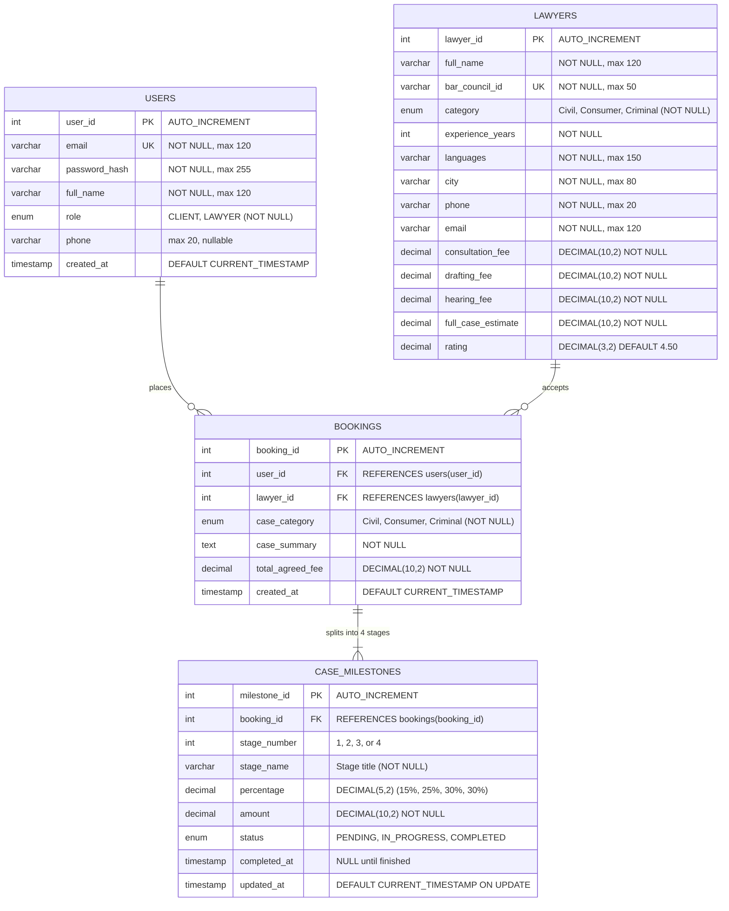

# NyayaConnect Backend Architecture & Implementation Plan
**Role:** Person 2 — Backend Architect & Relational Database Engineer  
**Stack:** Headless Python FastAPI (Port 8000), SQLAlchemy, MySQL Workbench / PostgreSQL / SQLite, Pydantic v2  
**Target Delivery:** Interactive Swagger UI (`/docs`), OpenAPI 3.0 Contract (`openapi.json`), and Pytest Suite  

---

## 1. Executive Summary & Team Role Boundaries

NyayaConnect is an automated legal aid and lawyer marketplace platform aligned with **SDG 16 (Peace, Justice, and Strong Institutions)**. The development team operates with strict role separation:

- **Person 1 (Frontend):** Next.js / React client application (Separate workspace).
- **Person 2 (You / Me - Backend & DB):** Strictly headless Python FastAPI REST API server (Port 8000) and relational SQL database. **Zero frontend files (No HTML, CSS, React, Jinja2).**
- **Person 3 (RAG AI):** Retrieval-Augmented Generation legal triage agent (Separate workspace).
- **Person 4 (DevOps & Integration):** Cloud DB provisioning, API Gateway, and CI/CD pipelines.

---

## 2. Entity-Relationship (ER) Diagram

The transactional database consists of four normalized relational tables designed to enforce financial precision with `DECIMAL(10,2)` and eliminate race conditions during milestone fee breakdowns.



### Table Specifications & Constraints
1. **`users` Table:**
   - Client and Lawyer authentication credentials.
   - Enforces unique email constraint and secure bcrypt password hashing.
2. **`lawyers` Table:**
   - Legal marketplace directory with verified `bar_council_id` (Unique).
   - Category ENUM strictly restricted to `'Civil'`, `'Consumer'`, `'Criminal'`.
   - Explicit 4-tier transparent fee schedule (`consultation_fee`, `drafting_fee`, `hearing_fee`, `full_case_estimate`) stored as `DECIMAL(10,2)`.
3. **`bookings` Table:**
   - Transactional link between a client user and a chosen lawyer.
   - Captures the initial agreed case fee and summary.
4. **`case_milestones` Table:**
   - Automatically populated with 4 linked stages upon booking creation:
     - **Stage 1 (15%):** Consultation & Case Assessment
     - **Stage 2 (25%):** Legal Notice & Document Drafting
     - **Stage 3 (30%):** Court Filing & First Hearing
     - **Stage 4 (30%):** Trial Proceedings & Final Arguments
   - Mathematical check: $15\% + 25\% + 30\% + 30\% = 100\%$. All individual milestone allocations round with precision `DECIMAL(10,2)`.

---

## 3. Headless REST API Specification (Port 8000)

FastAPI serves standard JSON responses and auto-generates OpenAPI 3.0 documentation at `http://localhost:8000/docs`.

### Authentication Endpoints (`/api/v1/auth`)
| Method | Endpoint | Description | Request Body | Response (200/201) | Access |
|---|---|---|---|---|---|
| `POST` | `/api/v1/auth/register` | Register client or lawyer | `UserRegisterSchema` | `{ "user_id": 1, "email": "...", "role": "CLIENT" }` | Public |
| `POST` | `/api/v1/auth/login` | Authenticate user & get JWT token | `OAuth2PasswordRequestForm` / JSON | `{ "access_token": "...", "token_type": "bearer", "role": "..." }` | Public |
| `GET` | `/api/v1/auth/me` | Fetch authenticated user profile | None (Bearer Token) | `UserOutSchema` | Authenticated |

### Lawyer Marketplace Endpoints (`/api/v1/lawyers`)
| Method | Endpoint | Query / Body Params | Description | Access |
|---|---|---|---|---|
| `GET` | `/api/v1/lawyers` | `category`, `max_budget`, `city`, `language`, `sort_by`, `skip`, `limit` | Multi-filter search across lawyer directory | Public |
| `GET` | `/api/v1/lawyers/{lawyer_id}` | Path: `lawyer_id: int` | Detailed lawyer profile with fee schedule and category average fee benchmark comparison | Public |
| `POST` | `/api/v1/lawyers/recommend` | Body: `{ "category": "Civil", "complexity": "Medium", "max_budget": 50000 }` | RAG Integration endpoint (Person 3) returning top 3 matching verified lawyers | Public / Internal |

### Smart Milestone Booking Endpoints (`/api/v1/bookings`)
| Method | Endpoint | Description | Request Body | Response (201/200) | Access |
|---|---|---|---|---|---|
| `POST` | `/api/v1/bookings` | Create atomic case booking & spawn 4 linked milestone rows | `BookingCreateSchema` (`lawyer_id`, `case_category`, `case_summary`) | Created booking details + array of 4 generated milestones | Client (JWT) |
| `GET` | `/api/v1/bookings` | List user's active/past bookings | Query: `skip`, `limit` | List of bookings with milestone statuses | Authenticated |
| `GET` | `/api/v1/bookings/{booking_id}` | Detailed booking view with 4 milestone stages | Path: `booking_id: int` | Single booking with milestone progress | Authenticated |
| `PATCH` | `/api/v1/bookings/{booking_id}/milestones/{stage_no}` | Update milestone stage status (`PENDING` $\to$ `IN_PROGRESS` $\to$ `COMPLETED`) | Body: `{ "status": "COMPLETED" }` | Updated milestone stage with timestamp audit | Lawyer / Admin |

---

## 4. Multi-Engine Relational Database Architecture

The backend supports seamless switching across database backends configured via `.env`:

```
                 ┌────────────────────────────────┐
                 │       FastAPI Application      │
                 └───────────────┬────────────────┘
                                 │
                     SQLAlchemy SessionLocal
                                 │
          ┌──────────────────────┼──────────────────────┐
          ▼                      ▼                      ▼
┌──────────────────┐   ┌──────────────────┐   ┌──────────────────┐
│  Local MySQL     │   │  Cloud PostgreSQL│   │  Local SQLite    │
│  Workbench       │   │  (Supabase/AWS)  │   │  Fallback        │
│  (mysql+pymysql) │   │  (postgresql)    │   │  (sqlite3)       │
└──────────────────┘   └──────────────────┘   └──────────────────┘
```

- **Primary Source:** Reads `DATABASE_URL` from `.env`.
- **Automatic Fallback:** If `DATABASE_URL` points to MySQL or PostgreSQL but the service is unreachable or credentials fail during initial setup, `database.py` seamlessly falls back to local SQLite (`sqlite:///./nyayaconnect.db`) and logs a diagnostic warning.
- **Data Integrity:** All models and queries are dialect-agnostic using standard SQLAlchemy ORM constructs.

---

## 5. Execution Roadmap

- [x] **STEP 1: Scaffolding & Virtual Environment Setup (Completed)**
  - Initialize directory structure: `routers/`, `auth/`, `tests/`.
  - Create configuration: `database.py`, `models.py`, `schemas.py`, `main.py`, `schema.sql`, `seed_data.py`.
  - Set up `.env.example`, `.gitignore`, and `requirements.txt`.
  - Initialize `.venv` Python virtual environment.
- [x] **STEP 2: Normalized Schema & 30-Lawyer Seed Data (Completed)**
  - Implement full ORM models in `models.py` and pure SQL DDL in `schema.sql`.
  - Generate `seed_data.py` with 30 realistic Indian lawyers (10 Civil, 10 Consumer, 10 Criminal) across Bengaluru and major metro cities with zero foreign key violations.
  - Verified 30/30 lawyers and test user accounts populated with `DECIMAL(10,2)` precision.
- [x] **STEP 3: Lawyer Directory & Multi-Filter Search APIs (Completed)**
  - Implement `routers/lawyers.py` with multi-parameter filtering (`category`, `max_budget`, `city`, `language`, `sort_by`).
  - Implement `GET /api/v1/lawyers/{lawyer_id}` with dynamic category average benchmark calculation and `fee_comparison_badge`.
  - Implement `POST /api/v1/lawyers/recommend` endpoint for Person 3's RAG service returning top 3 matching lawyers.
  - Verified sub-30ms response latency (measured ~10.10ms) and 14/14 Pytest tests passing.
- [x] **STEP 4: Smart Milestone Booking & Fee Engine (Completed)**
  - Built atomic booking transaction logic (`POST /api/v1/bookings`) with rollback protection.
  - Automated 4-stage milestone generation (Stage 1 15%, Stage 2 25%, Stage 3 30%, Stage 4 30%) with exact `DECIMAL(10,2)` arithmetic (100% sum match).
  - Built `GET /api/v1/bookings/user/{user_id}` and `GET /api/v1/bookings/{booking_id}` for Person 1's dashboard.
  - Implemented sequential milestone state transition engine (`PATCH /api/v1/bookings/{booking_id}/milestones/{stage_no}`) enforcing completion of earlier stages before advancing, with timestamp auditing.
  - Verified 19/19 Pytest tests passing.
- [x] **STEP 5: JWT Authentication & Role-Based Access Control (Completed)**
  - Implemented `auth/jwt_handler.py` with `passlib[bcrypt]` and `python-jose` for JWT creation, decoding, and FastAPI security dependencies.
  - Implemented `routers/auth.py` supporting `POST /api/v1/auth/register` and `POST /api/v1/auth/login` for both `'CLIENT'` and `'LAWYER'` roles.
  - Added dependency guard `get_current_user` to protected booking endpoints, rejecting unauthenticated requests with HTTP 401.
  - Verified 22/22 Pytest tests passing.
- [x] **STEP 6: Pytest Suite & OpenAPI Contract Export (Completed)**
  - Configured explicit CORS middleware in `main.py` allowing Person 1 (`http://localhost:3000`) and Person 3 (`http://localhost:8001`) with full credentials, methods, and headers.
  - Automated 100% passing Pytest suite (24/24 tests passed in 4.77s) covering lawyer filtering, decimal math accuracy, milestone lock transitions, 401 unauthenticated route rejections, and JWT role verification.
  - Exported complete OpenAPI 3.0 specification to `openapi.json` (11 endpoints).
  - Committed verified codebase to Git with `.env`, `.venv`, and `__pycache__` safely ignored.
